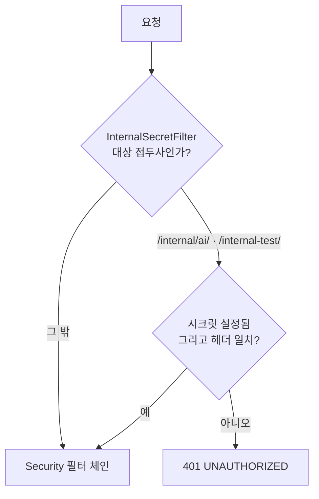

> **성과:** 운영 도메인에서 인증 없이 열려 있던 LLM 호출 엔드포인트를, Nginx 설정에 기대지 않고 서버의 공유 시크릿 필터가 막도록 고치고 테스트 6건으로 고정했습니다.

## 상황과 내 역할

소때잡의 Spring 서버와 AI 서버(FastAPI)는 내부 API로 서로를 부릅니다. 내부 API는 `X-Internal-Secret` 헤더의 공유 시크릿으로 보호합니다. 2026년 9월 10일, 팀원이 EC2 배포본으로 세 저장소 연동 리허설을 하다가, 운영 도메인에서 `/internal-test/ai-ping`이 **인증 없이 200**을 돌려주는 것을 실측해 이슈 #75로 올렸습니다. 저는 이 이슈의 수정 PR을 맡았습니다.

## 문제와 제약

`ai-ping`은 연동 확인용 엔드포인트로, 호출할 때마다 AI 서버의 `/chat`을 거쳐 LLM을 한 번 부릅니다. 누구나 이 주소를 반복 호출하면 OpenAI 비용과 메모리 1.9GiB 인스턴스의 부하를 일으킬 수 있었습니다.

원인은 코드 주석에 적힌 전제였습니다. `SecurityConfig`는 `/internal-test/**`를 `permitAll`로 두고, "운영에서는 프록시가 `/internal` 접두사를 막는다"는 주석에 기댔습니다. 그런데 실제 Nginx는 그 접두사를 막고 있지 않았습니다. Nginx 설정은 저장소 밖 EC2에 있어서, 이 전제를 코드 리뷰나 테스트로 확인할 방법이 없었습니다.

## 검토한 대안과 선택 기준

- **Nginx에서 `/internal` 접두사 막기:** 설정 한 줄이면 되지만 저장소 밖에 있어 버전 관리도 테스트도 되지 않습니다. 같은 전제가 또 틀릴 수 있습니다.
- **필터 대상을 `/internal/`로 넓히기:** 이슈가 제안한 방향입니다. 그런데 `/internal-test/ai-ping`은 `/internal/`로 시작하지 않습니다(`/internal` 뒤가 `/`가 아니라 `-`). 그대로 넓히면 정작 문제의 주소를 잡지 못합니다.
- **필터 대상 접두사를 명시적으로 둘 두기:** `/internal/ai/`와 `/internal-test/`를 각각 적습니다. 선택했습니다.

선택 기준은 "보호가 저장소 안의 코드와 테스트로 증명되는가"였습니다. Nginx 차단은 버리지 않고, 사람이 EC2에서 추가로 거는 선택적 이중 방어로 README에 절차를 남겼습니다.

## 해결 방법

- `InternalSecretFilter`의 대상 접두사를 하나(`/internal/ai/`)에서 둘(`/internal/ai/`, `/internal-test/`)로 늘렸습니다.
- 헤더 비교는 `MessageDigest.isEqual` 상수 시간 비교를 그대로 씁니다. 서버에 시크릿이 설정되지 않았으면 올바른 헤더를 보내도 401입니다. "로컬이니까 시크릿을 비워 둔다"가 운영까지 따라가는 실수를 막습니다.
- `SecurityConfig`의 "운영 프록시가 막는다" 주석을 지우고, "필터가 요구한다"로 고쳤습니다. 잘못된 전제가 주석으로 남아 있으면 다음 사람이 또 기댈 수 있습니다.
- README·AGENTS·CONTRIBUTING의 로컬 확인 명령을 헤더를 붙인 `curl`로 바꾸고, "헤더가 없으면 401이 정상"을 적었습니다.

## 검증된 결과

`InternalSecretFilterTest` 6건을 새로 만들었습니다.

1. `ai-ping`에 헤더가 없으면 401 오류 응답
2. 맞는 헤더는 통과
3. 틀린 헤더는 401
4. 기존 `/internal/ai/**` 동작은 그대로
5. 공개 경로(`/actuator/health`, `/auth/login`)는 필터를 타지 않음
6. 시크릿이 비어 있으면 맞는 헤더라도 401

내부 API와 설정 테스트 18건이 로컬에서 통과했고, DB 통합 테스트를 포함한 PR의 CI 빌드도 통과했습니다.

## 남은 한계와 회고

배포 뒤 운영 도메인에서 헤더 없는 호출이 401이 되는지는 PR 기록에 남아 있지 않습니다. 이 글에서도 운영 확인을 마쳤다고 쓰지 않습니다.

"프록시가 막는다"는 전제는 주석에만 있었고, 그 전제를 확인하는 테스트는 없었습니다. 그래서 전제가 틀렸는데도 운영에서 실측하기 전까지 아무도 알지 못했습니다. 이 수정은 전제를 테스트가 붙은 서버 코드로 옮긴 것입니다. 다만 같은 서버 안의 다른 `permitAll` 경로가 비슷한 전제에 기대고 있는지 전수 조사한 기록은 PR에 없습니다.

## 근거

- 발견: [이슈 #75](https://github.com/jittaejap/sottaejap-server/issues/75)(팀원의 운영 실측), [이슈 #73](https://github.com/jittaejap/sottaejap-server/issues/73)(연동 리허설)
- 수정과 검증: [server PR #79](https://github.com/jittaejap/sottaejap-server/pull/79)
