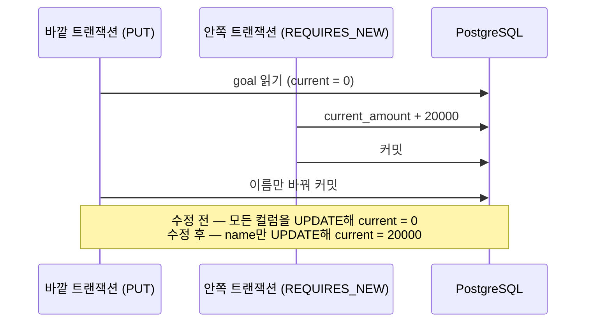

> **성과:** Hibernate가 엔티티의 전체 컬럼을 UPDATE해 다른 트랜잭션이 더한 실적을 덮어쓰는 문제를 실제 PostgreSQL에서 재현하고, 수정을 되돌리면 테스트가 실패하는 것까지 확인했습니다.

## 상황과 내 역할

소때잡 사용자는 절약 목표를 세우고, 월간 리포트가 확정될 때 그달 절감액이 목표 실적(`currentAmount`)에 더해집니다. 저는 월간 리포트와 목표 실적 배분을 구현했습니다. 그 PR(#32)을 리뷰한 팀원이 "목표 이름 수정과 실적 배분이 겹치면 실적이 사라질 수 있다"고 지적했습니다. 저는 이 지적을 이슈 #36으로 분리하고, 재현과 수정을 맡았습니다.

## 문제와 제약

실적 배분은 `current_amount = current_amount + ?` 형태의 JPQL로 DB에서 원자적으로 더합니다. 문제는 목표 수정 API `PUT /goals/{id}`였습니다. 이 API는 `Goal` 엔티티를 읽어 이름을 바꾸고, Hibernate의 더티 체킹이 **모든 컬럼**을 UPDATE합니다. 그래서 요청이 자기가 읽어 둔 옛 `currentAmount`까지 다시 씁니다.

```text
Tx1 (월간 리포트 확정)  update goals set current_amount = current_amount + 20000
Tx2 (이름만 변경)       select goal (current = 0) … update goals set name = …, current_amount = 0
                        → 20,000원 실적이 사라짐
```

API 계약은 "`currentAmount`를 생략하면 그대로 둔다"였습니다. 그런데 실제 동작은 "메모리에 읽어 둔 옛 값을 되쓴다"였습니다. 시점도 제약이었습니다. 수정은 해커톤 본선 전날 들어가야 했으므로, 클라이언트까지 바꿔야 하는 해결책은 쓸 수 없었습니다.

## 검토한 대안과 선택 기준

| 대안                                            | 장점                                 | 버린 이유                                                                               |
| ----------------------------------------------- | ------------------------------------ | --------------------------------------------------------------------------------------- |
| JPQL 부분 갱신 (`name`·`targetAmount`만 UPDATE) | 의도가 SQL에 그대로 보임             | 엔티티 수정 경로와 JPQL 경로로 update가 둘로 갈라짐                                     |
| `@Version` 낙관적 잠금                          | 경합을 감지해 한쪽을 409로 거절      | API 명세에 없는 409를 새로 만들어야 하고, 실적 배분 JPQL도 version을 올리도록 고쳐야 함 |
| `@DynamicUpdate`                                | 바뀐 컬럼만 UPDATE, 어노테이션 한 줄 | 선택                                                                                    |

선택 기준은 "새 오류 계약 없이, 본선 전날 안전하게 넣을 수 있는가"였습니다. `@DynamicUpdate`가 영향을 줄 수 있는 설정도 확인했습니다. 이 저장소에는 2차 캐시와 JDBC 배치 설정이 없어 부작용이 생길 곳이 없었습니다.

## 해결 방법



먼저 `GoalUpdateRaceIntegrationTest`로 경합 순서를 고정했습니다. 바깥 트랜잭션이 목표를 읽고, `REQUIRES_NEW` 트랜잭션이 20,000을 더해 커밋한 뒤, 바깥이 이름만 바꿔 커밋합니다. 스레드 두 개의 타이밍에 기대지 않고 한 스레드 안에서 `TransactionTemplate` 두 개로 순서를 고정했으므로, 매번 같은 결과가 나옵니다.

그다음 `Goal`에 `@DynamicUpdate`를 붙였습니다. 생략한 `currentAmount`는 SQL에 실리지 않으므로, 어느 트랜잭션이 먼저 커밋하든 배분이 남습니다.

## 검증된 결과

- 수정한 상태에서 테스트가 통과합니다(`currentAmount = 20000`, 이름과 목표액은 바뀜).
- 어노테이션을 지운 상태에서는 `expected: <20000> but was: <0>`으로 실패합니다. 테스트가 실제로 문제를 잡는지 확인한 뒤 원복했습니다.
- 리뷰어가 "같은 조건의 엔티티가 더 있다"고 짚었습니다. `User`(설정 변경 ↔ 재계산), `Suggestion`(재계산 ↔ 사용자 채택), `BehaviorCluster`(재계산 ↔ 이름 짓기)에도 어노테이션을 붙이고 재현 테스트 3건을 더했습니다. 세 엔티티에서 어노테이션을 빼면 3건 모두 실패하는 것도 확인했습니다.
- DB 통합 테스트를 포함한 로컬 빌드에서 504건이 통과했고, PR의 CI 빌드도 통과했습니다. 테스트가 만든 행이 남지 않은 것도 확인했습니다.

팀의 결정 로그에는 일반 규칙을 E-100으로 남겼습니다. "서로 다른 요청이 겹치지 않는 컬럼을 각자 읽어 고치는 엔티티는 바뀐 컬럼만 쓴다."

## 남은 한계와 회고

`PUT`에 `currentAmount`를 **직접 적어 보낸** 요청과 배분이 겹치면, 여전히 나중 값이 이깁니다. 사용자가 실적을 직접 고친 경우라 의도된 동작으로 두었고, 이 경우는 테스트하지 않았습니다. 클라이언트가 목표 수정 화면을 연결할 때 `currentAmount`를 보내지 않도록 클라이언트 이슈에 메모를 남겼습니다.

`@DynamicUpdate`는 엔티티마다 어노테이션 한 줄이라, 누군가 지우면 문제가 그대로 돌아옵니다. 그래서 서버의 `AGENTS.md`에 "지우면 #36이 되살아난다"를 적고, 엔티티 4종의 재현 테스트 4건이 각 어노테이션을 지키게 했습니다.

## 근거

- 발견과 분리: [server PR #32 리뷰](https://github.com/jittaejap/sottaejap-server/pull/32), [이슈 #36](https://github.com/jittaejap/sottaejap-server/issues/36)
- 수정과 검증: [server PR #42](https://github.com/jittaejap/sottaejap-server/pull/42)
- 결정: [결정 로그](https://github.com/jittaejap/sottaejap-docs/blob/main/01_%EA%B2%B0%EC%A0%95%EB%A1%9C%EA%B7%B8.md) E-100
