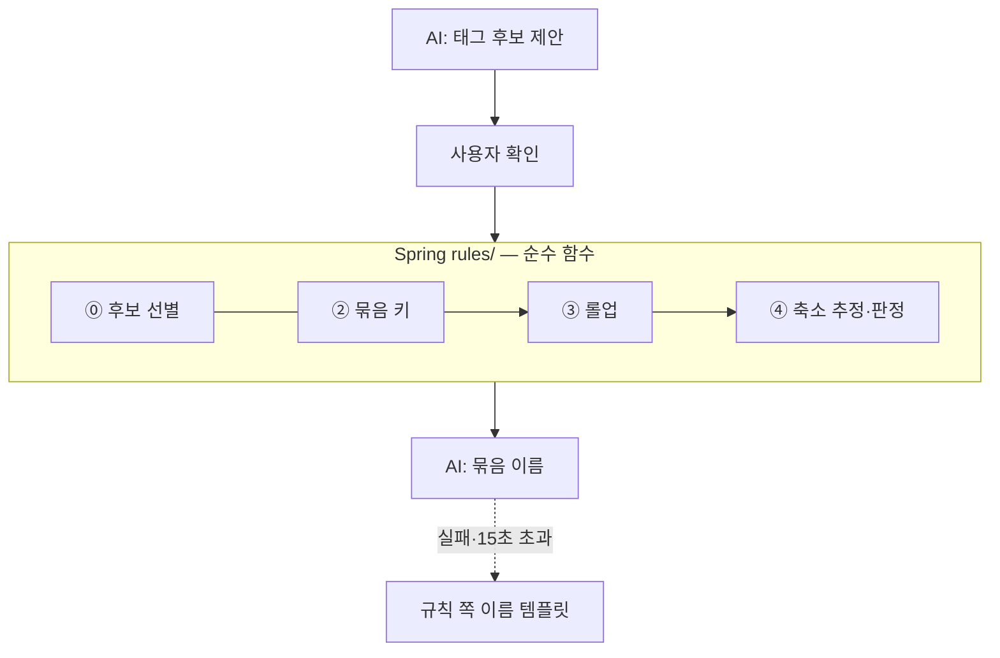

> **성과:** 소비 묶음·판정·후보 선별을 난수와 현재 시각을 쓰지 않는 순수 함수로 구현하고, 소스 스캔 테스트로 비결정 코드가 규칙 패키지에 들어오지 못하게 막았습니다.

## 상황과 내 역할

소때잡은 사용자가 며칠 지난 카드 소비를 돌아보고 "지킬 소비"와 "줄일 소비"를 가르도록 돕는 서비스입니다. 회고가 쌓이면 서버가 비슷한 소비를 묶고, 묶음마다 만족도를 판정해 지도에 올립니다. 저는 Spring 서버의 규칙 엔진 중 회고 후보 선별(⓪), 묶음 키(②), 롤업(③), 축소 추정과 판정(④), 월 부담 계산을 구현했습니다. 이 규칙을 화면이 부를 수 있게 만든 회고 API도 제가 구현했습니다.

## 문제와 제약

AI가 묶음과 판정까지 맡으면, 같은 소비 기록을 넣어도 호출할 때마다 결과가 달라질 수 있습니다. 어제 "줄일 소비"였던 묶음이 새로고침 한 번에 "지킬 소비"로 바뀌면 사용자는 결과를 믿을 수 없습니다. 팀은 요구사항 NFR-01에 "동일 데이터 → 항상 동일한 분석 결과"를 적었습니다. 그런데 이 요구사항은 코드 리뷰만으로는 지켜지지 않습니다. 누군가 규칙 안에서 `LocalDate.now()`를 한 번만 불러도 결과가 날짜에 따라 달라집니다.

규칙 수치도 아직 정해지지 않았습니다. 축소 추정 강도나 롤업 기준 같은 값은 실데이터가 쌓인 뒤 조정하기로 했고, 해커톤 기간에는 잠정값으로 돌려야 했습니다.

## 검토한 대안과 선택 기준

- **규칙을 AI 서버(FastAPI)에 두기:** 처음 계획이었습니다. 팀은 결정 E-18에서 규칙 엔진을 Spring으로 옮기고, FastAPI에는 에이전트·자연어·RAG·설명만 남겼습니다.
- **목적·동행인을 임베딩 유사도로 정규화하기:** 사용자가 쓴 자유 문장을 임베딩해 가장 가까운 태그에 붙이는 방식입니다. 팀은 E-20에서 이 방식을 폐기했습니다. 대신 AI는 표준 태그 후보만 제안하고, 사용자가 확인한 값만 저장합니다. 그러면 NFR-01이 보장할 범위가 "사용자가 확인한 입력 이후"로 분명해집니다.
- **결정론을 Python 테스트로 증명하기:** 규칙이 Spring으로 옮겨 왔으므로 증명 테스트도 Spring JUnit으로 옮겼습니다(E-29).

선택 기준은 "같은 입력에 같은 결과를 테스트로 증명할 수 있는가"였습니다. 그래서 AI는 입구(회고 후보 제안)와 출구(묶음 이름, 설명 문장)에만 남았습니다. 사용자가 확인한 입력 이후의 묶음·보정·판정·집계는 전부 서버 규칙이 소유합니다.

## 해결 방법

- **현재 시각은 밖에서 넣습니다.** `ClockConfig`가 서비스 계층에 시계를 주입하고, `rules/` 패키지는 `now()`를 부르지 않습니다. `ClusterEngine`은 입력 레코드를 받아 결과 레코드를 돌려줄 뿐 DB나 외부를 건드리지 않습니다.
- **비결정 코드를 소스 스캔으로 막습니다.** 서버 초기 구성 때 만든 `RuleEngineDeterminismTest`가 `rules/` 아래 모든 소스에서 `Random`, `UUID.randomUUID`, `Instant.now`, `RestClient`, AI 패키지 import 같은 토큰 17종을 찾습니다. 하나라도 나오면 테스트가 실패합니다.
- **잠정값이 비면 계산을 거부합니다.** 규칙 수치는 `application.yml` 잠정값으로 주입하고 `RULES_*` 환경 변수로 덮어씁니다. 값이 비어 들어오면 규칙이 `RuleParamMissingException`을 일으킵니다. 틀린 기본값으로 조용히 계산하는 경로를 남기지 않으려는 선택입니다.
- **AI 호출은 DB 잠금 밖에서 합니다.** 회고 저장 메서드에는 트랜잭션을 걸지 않고, 짧은 트랜잭션은 `RetrospectWriter`만 쥡니다. 저장 뒤 새 묶음의 이름을 AI에 묻는 동안(최대 15초) DB 연결을 붙잡지 않습니다. AI가 실패하면 `"{시간대} {카테고리}"` 형태의 템플릿 이름을 씁니다.

## 검증된 결과

규칙별 골든 테스트 9개가 산식 문서(04 §3)의 기대값을 고정합니다. 규칙 PR의 로컬 빌드에서 테스트 152건이 통과했고, DB가 필요한 12건은 환경 변수 게이트로 건너뛰었습니다. 같은 PR의 CI 빌드도 통과했습니다.

리뷰에서 반드시 고칠 지적 5건을 받았습니다. 그중 하나는 `.env.example`의 "값을 비우면 잠정값이 들어간다"는 안내가 사실과 반대라는 지적이었습니다. 실제로는 값을 비우면 숫자는 `null`, 목록은 빈 목록이 들어갑니다. 저는 안내 문구를 고치고, "값을 비우면 `null`이 된다"를 바인딩 테스트로 고정했습니다. 이전 CI는 "키를 안 넣으면 뜬다"만 증명하고 있었습니다. 리뷰를 반영하는 동안 계산 로직과 골든 테스트 기대값은 바꾸지 않았습니다.

## 남은 한계와 회고

규칙 수치는 여전히 잠정값입니다. 실데이터가 쌓이면 값을 바꾸고, 골든 테스트 기대값도 함께 바꿔야 합니다. 소스 스캔은 금지 목록에 있는 토큰만 찾습니다. 목록에 없는 새 비결정 API가 들어오면 통과하므로, 골든 테스트가 그 빈틈을 함께 막아야 합니다.

협업 경계도 밝혀 둡니다. 절감액 규칙(⑦)과 집계 규칙(⑧)은 팀원이 데모 저장소에서 먼저 구현했고, 저는 그 구현을 본 저장소로 옮기는 PR을 올렸습니다. 이 사례의 구현 범위에는 넣지 않았습니다.

## 근거

- 결정: [결정 로그](https://github.com/jittaejap/sottaejap-docs/blob/main/01_%EA%B2%B0%EC%A0%95%EB%A1%9C%EA%B7%B8.md) E-18·E-20·E-29·E-57·E-64, 요구사항 NFR-01
- 구현: [server PR #6](https://github.com/jittaejap/sottaejap-server/pull/6)(규칙 ⓪②③④), [server PR #10](https://github.com/jittaejap/sottaejap-server/pull/10)(회고 API와 이름 템플릿 폴백)
- 결정론 테스트: [RuleEngineDeterminismTest.java](https://github.com/jittaejap/sottaejap-server/blob/main/src/test/java/kr/sottaejap/server/rules/RuleEngineDeterminismTest.java)
