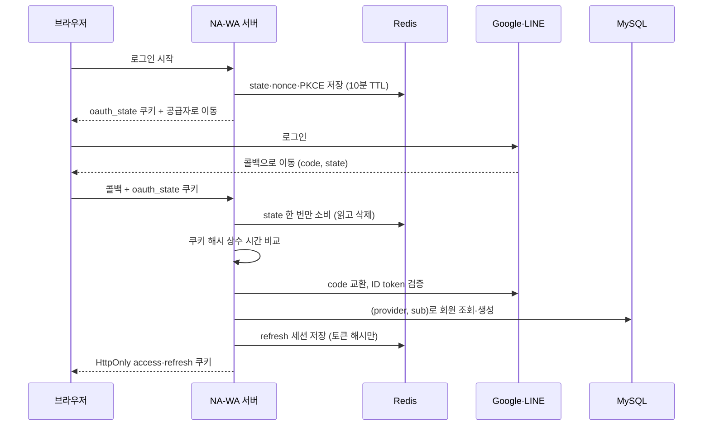

> **성과:** Google·LINE OAuth 2.0/OIDC 로그인의 인가 요청·코드 교환·ID token 검증을 직접 구현하고, 임시 상태는 Redis TTL에, 회원 원본은 MySQL에 두었습니다. 구현 뒤 발견한 틈 두 개는 별도 PR로 닫았습니다.

## 상황과 내 역할

NA-WA는 방한 외국인 여행자를 위한 서비스라 Google과 LINE 로그인을 지원합니다. 소셜 로그인은 팀의 첫 도메인 기능이었고, 공용 UI가 정해지기 전이라 백엔드 인증 계약을 먼저 완성해야 했습니다. 저는 로그인 시작부터 콜백, 회원 생성, NA-WA 세션 발급까지 백엔드 인증 흐름 전체를 구현했습니다. 이후 콜백의 브라우저 바인딩과 refresh 때 회원 상태 검증을 별도 PR로 보강했습니다. 프런트엔드 로그아웃 장벽은 [다음 사례](/posts/na-wa-sign-out-barrier/)에서 다룹니다.

## 문제와 제약

- **상태의 수명이 서로 다릅니다.** OAuth `state`·nonce·PKCE verifier는 10분이면 버려도 되는 임시 값입니다. 회원과 소셜 계정의 연결은 영구 원본입니다. refresh 세션은 그 중간으로, 14일 동안 살아 있다가 회전합니다.
- **계정 연결이 탈취 경로가 될 수 있습니다.** 이메일이 같다는 이유로 Google 계정과 LINE 계정을 합치면, 이메일을 검증하지 않는 공급자를 거쳐 남의 계정에 들어갈 수 있습니다. LINE은 이메일을 주지 않는 계정도 있습니다.
- **토큰이 새면 안 됩니다.** 토큰과 개인정보가 리다이렉트 URL, 로그, `localStorage`에 남지 않아야 합니다.
- **환경 제약:** 백엔드는 Spring Boot 없이 Spring MVC 5.3을 WAR로 Tomcat 9에 배포합니다. 인증 설정도 자동 구성 없이 직접 등록해야 했습니다.

## 검토한 대안과 선택 기준

| 결정                | 검토한 대안                                 | 선택                                                                                                                              |
| ------------------- | ------------------------------------------- | --------------------------------------------------------------------------------------------------------------------------------- |
| 로그인 흐름         | Spring Security의 `oauth2Login()` 자동 흐름 | 인가 요청·코드 교환·콜백을 서비스 계층에 직접 구현하고, Google ID token 서명 검증에만 Spring Security의 `NimbusJwtDecoder`를 사용 |
| refresh 세션 저장소 | MySQL `auth_refresh_tokens` 테이블          | Redis 세션. MySQL 테이블은 Redis와 책임이 겹쳐 제거                                                                               |
| 계정 식별           | 이메일 기준 자동 병합                       | `(provider, provider_user_id)` 기준. 같은 이메일이어도 합치지 않음                                                                |
| 콜백 바인딩(#220)   | 탭마다 따로 state 쿠키                      | 브라우저당 쿠키 하나. 두 탭에서 동시에 시작하면 나중 쪽만 성공하지만, 구현이 단순                                                 |

선택 기준은 "각 상태가 어느 저장소의 책임인지 한 문장으로 말할 수 있는가"였습니다. MySQL은 회원과 소셜 계정 연결의 원본, Redis는 다시 만들 수 있는 TTL 인증 상태, Spring Security는 CORS와 API 인증, Nginx는 프록시만 맡습니다.

## 해결 방법

- **임시 상태는 한 번만 씁니다.** 콜백은 Redis Lua 스크립트로 state를 읽는 동시에 지웁니다. 같은 state로 두 번 콜백할 수 없습니다.
- **ID token은 공급자별로 검증합니다.** Google은 JWK로 RS256 서명, 발급자, 대상, 만료를 검증하고 nonce를 상수 시간으로 비교합니다. LINE은 공급자의 검증 엔드포인트에 nonce를 함께 보내 확인하고, 응답의 발급자와 대상을 다시 비교합니다. LINE에는 PKCE(S256)를 적용했습니다.
- **동시 첫 로그인을 처리합니다.** 같은 계정으로 두 요청이 동시에 처음 들어오면 한쪽이 유일 제약에 걸립니다. 이때 실패로 끝내지 않고 먼저 만들어진 회원을 다시 조회합니다.
- **refresh는 원자적으로 회전합니다.** refresh 토큰 원문이 아니라 해시만 Redis에 저장합니다. 회전은 Lua 스크립트 하나가 해시 비교와 교체를 함께 처리합니다. 이미 회전된 토큰이 다시 들어오면 재사용으로 보고 세션을 폐기합니다.

### 구현 뒤 닫은 틈 두 개

- **#220 로그인을 시작한 브라우저에서만 콜백 완료:** 로그인을 시작할 때 난수를 `oauth_state` 쿠키로 심고, Redis에는 그 SHA-256 해시만 저장합니다. 콜백에서 쿠키가 없거나 해시가 다르면 공급자와 통신하기 전에 거부합니다. 공급자 콜백은 외부 사이트에서 오는 최상위 이동이라, 이 쿠키만 `SameSite=Lax`로 고정했습니다. 운영을 `Strict`로 두면 쿠키가 실려 오지 않아 모든 로그인이 조용히 실패하기 때문입니다.
- **#142 refresh 전에 회원 상태 확인:** 정지되거나 탈퇴한 회원도 refresh 토큰만 있으면 새 토큰을 받을 수 있었습니다. 이제 회전 직전에 MySQL에서 회원 상태를 확인하고, `ACTIVE`일 때만 회전합니다. DB 조회가 실패하거나 상태를 알 수 없으면 회전하지 않습니다.

## 검증된 결과

- **#41:** 로컬 MySQL·Redis 통합 테스트를 포함해 백엔드 테스트 148건이 통과했습니다. 실제 Google·LINE 계정으로 브라우저 왕복 로그인을 하고 `/auth/me`를 확인했습니다. 같은 LINE 계정으로 다시 로그인하면 회원 ID가 유지되고, MySQL 연결 행이 1개뿐인 것도 확인했습니다.
- **#142:** 상태 검사 호출을 임시로 지우면 정지 회원 회귀 테스트가 실패하고, 되돌리면 통과하는 것을 확인했습니다.
- **#220:** 인증·설정 테스트 160건이 통과했습니다. Redis 통합 테스트 5건은 실제로 실행됐는지 XML 리포트에서 `skipped=0`으로 확인했습니다.
- 세 PR 모두 CI가 통과했습니다.

## 남은 한계와 회고

#220 뒤에는 실제 Tomcat 기동과 브라우저 로그인 왕복을 다시 하지 못했습니다. 로컬에 공급자 비밀값이 없었기 때문이고, PR에 스모크 테스트 절차를 남겨 다른 팀원에게 요청했습니다. #142는 로컬에서 MySQL·Redis 통합 테스트를 돌리지 못해 CI 결과에 기댔습니다.

정지된 회원이라도 이미 받은 access token은 만료(15분)까지 유효합니다. 회원별 세션 색인과 access token 즉시 폐기는 범위 밖으로 두었습니다. MySQL 상태 확인과 Redis 회전은 다른 저장소라 분산 트랜잭션으로 묶지 않았습니다.

구현을 끝낸 뒤에도 틈은 남아 있었습니다. 그래서 틈마다 이슈를 따로 열고, 각 PR에 "무엇을 확인했고 무엇을 확인하지 못했는지"를 나눠 적었습니다.

## 근거

- 구현: [PR #41](https://github.com/T-ravelers/NA-WA/pull/41), [Issue #23](https://github.com/T-ravelers/NA-WA/issues/23)
- 보강: [PR #220](https://github.com/T-ravelers/NA-WA/pull/220)(콜백 브라우저 바인딩), [PR #142](https://github.com/T-ravelers/NA-WA/pull/142)(refresh 회원 상태 검증)
- 운영 문서: [AUTHENTICATION.md](https://github.com/T-ravelers/NA-WA/blob/main/backend/docs/AUTHENTICATION.md)
