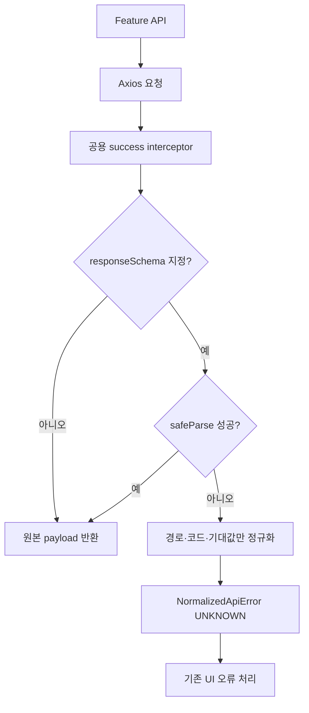

> **성과:** TypeScript 타입과 다른 백엔드 응답이 화면 깊숙이 전파되던 문제를, 기존 API 전체를 깨뜨리지 않는 요청별 Zod 검증과 feature가 소유하는 스키마로 차단했습니다.

## 상황과 내 역할

백엔드가 보낸 nullable 배열 날짜가 프론트엔드 타입과 달라 런타임 오류가 난 사건이 있었습니다. 그 뒤로 API 경계에서 실제 응답을 확인할 필요가 생겼습니다. 저는 공용 Axios 계약을 확장하고 Explore·Wallet의 스키마와 테스트를 작성해 읽기 요청 7개에 처음 적용했습니다.

## 문제와 제약

TypeScript의 제네릭은 컴파일 후 사라지므로 `get<Foo>()`가 실제 JSON을 보장하지 않습니다. 그렇다고 모든 요청에 검증을 한꺼번에 강제하면 기존 API 수십 개와 인증·CSRF·blob 오류 처리까지 동시에 흔들립니다. 반대로 각 composable에서 `safeParse`를 직접 반복하면 오류 형식과 로깅이 제각각이 됩니다. 공용 API 계층이 feature 스키마를 import하면 의존 방향도 뒤집힙니다.

## 검토한 대안과 선택 기준

| 대안                             | 판단                                                               |
| -------------------------------- | ------------------------------------------------------------------ |
| 전역 응답 스키마 강제            | 이상적 최종상은 될 수 있으나 마이그레이션 실패 반경이 너무 커 제외 |
| 각 호출부에서 직접 검증          | 빠르지만 중복·오류 형식 불일치 때문에 제외                         |
| 요청 config에 선택적 스키마 지정 | 기존 요청은 그대로 두고 위험한 경계부터 확장할 수 있어 선택        |

**점진적으로 도입할 수 있는가**, **기존 refresh/CSRF 흐름을 보존하는가**, **도메인이 스키마를 소유하는가**, **운영 로그에 민감한 payload를 남기지 않는가**를 기준으로 삼았습니다.

## 해결 방법

공용 Axios config에 선택 항목 `responseSchema`를 추가했습니다. 스키마가 없는 요청은 성공 응답의 원본 payload를 바로 반환합니다. 스키마를 지정한 요청만 success interceptor에서 `safeParse`로 검사하고, 통과하면 원본 payload를 반환합니다. 검증에 실패하면 query와 hash를 제거한 URL과 issue의 path·code·expected만 남기고 응답 본문은 오류 메시지에 넣지 않았습니다. 이 예외는 기존 `NormalizedApiError`로 합쳐지므로 호출부의 오류 처리를 그대로 재사용합니다.

스키마는 Explore와 Wallet feature가 각각 소유합니다. 상태·이벤트 종류처럼 모르는 값이 들어오면 잘못 동작하는 필드는 enum으로 엄격히 막았습니다. 서버가 나중에 새 값을 보내도 안전하게 표시할 수 있는 필드는 string과 UI fallback을 유지했습니다. Jackson이 반환할 수 있는 문자열/배열 날짜와 nullable 목록도 실제 계약에 맞게 모델링했습니다.

## 검증된 결과

Explore·Wallet의 읽기 요청 7개에 적용했습니다. 집중 테스트 8개 파일 76건, 전체 단위 테스트 94개 파일 494건, 포맷·린트·타입 검사·빌드를 통과했습니다. 인증 401과 blob 오류 경로가 기존 순서를 지키는지 확인하는 회귀 테스트도 넣었습니다. 당시 Zod를 도입하면서 생긴 스키마 청크는 65.17KB, gzip 17.51KB였고 PWA precache는 68.1KiB 늘었습니다. 실제 백엔드의 모든 Jackson 직렬화 조합을 브라우저에서 검증한 것은 아니므로 테스트 fixture 기반 증거와 구분했습니다.

## 남은 한계와 회고

선택적 검증은 스키마를 지정하지 않은 요청을 보호하지 않습니다. 대신 검증 실패가 실제로 나타나는 feature부터 스키마를 넓히고, 계약이 안정되면 공통 DTO 후보를 승격할 수 있습니다. 중요한 선택은 Zod 자체가 아니라 **전역 계층은 실행 메커니즘만 제공하고, 무엇이 유효한지는 도메인이 소유하게 한 것**입니다.

## 근거

- 배경과 구현: [Issue #160](https://github.com/T-ravelers/NA-WA/issues/160), [Issue #171](https://github.com/T-ravelers/NA-WA/issues/171), [PR #188](https://github.com/T-ravelers/NA-WA/pull/188)
- 핵심 코드: [responseSchema.ts](https://github.com/T-ravelers/NA-WA/blob/9ed7a70a3829fdb5fdc2e3e8373c32d740f249c8/frontend/src/shared/api/responseSchema.ts), [httpClient.ts](https://github.com/T-ravelers/NA-WA/blob/9ed7a70a3829fdb5fdc2e3e8373c32d740f249c8/frontend/src/shared/api/httpClient.ts)
- feature 소유권: [Explore schema](https://github.com/T-ravelers/NA-WA/blob/9ed7a70a3829fdb5fdc2e3e8373c32d740f249c8/frontend/src/features/explore/api/exploreResponseSchemas.ts), [Wallet schema](https://github.com/T-ravelers/NA-WA/blob/9ed7a70a3829fdb5fdc2e3e8373c32d740f249c8/frontend/src/features/wallet/api/walletResponseSchemas.ts)
