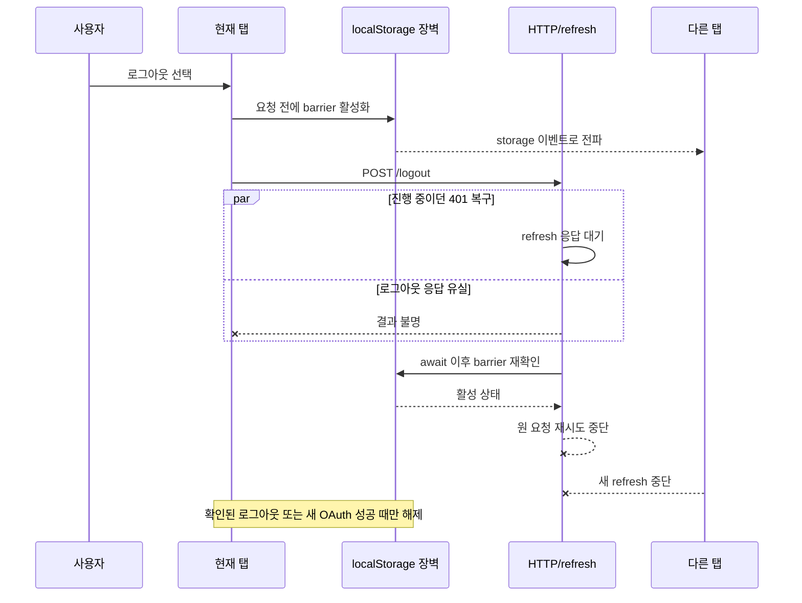

> **성과:** 로그아웃 요청을 보내고 응답을 받지 못한 상태를 성공이나 실패로 추측하지 않았습니다. 대신 브라우저가 새 인증을 확인할 때까지 refresh와 원 요청 재시도를 막는 영속 장벽을 설계했습니다.

## 상황과 내 역할

NA-WA 인증에서는 OAuth 로그인, HttpOnly refresh 쿠키, Redis 세션, Axios의 401 복구가 함께 동작합니다. 저는 소셜 로그인 기반, 로그아웃 계약, 비활성 회원 refresh 차단, 프론트엔드 로그아웃 장벽과 콜백 강화까지 단계적으로 구현했습니다. 이 사례에서는 그중 브라우저 경계의 문제, 곧 “로그아웃 직후 세션이 되살아나는가”를 다룹니다.

## 문제와 제약

로그아웃 중 네트워크가 끊기면 브라우저는 서버가 Redis 토큰을 폐기했는지 알 수 없습니다. 이 상황을 단순 실패로 보고 로그인 가드나 401 인터셉터가 refresh를 보내면, 서버가 로그아웃을 처리하지 못한 경우 세션이 되살아납니다. 메모리 플래그만 쓰면 새로고침할 때 사라집니다. 한 탭만 막으면 다른 탭이 refresh를 시작할 수 있습니다. 장벽보다 먼저 시작한 refresh가 장벽이 켜진 뒤에 끝나는 경쟁 조건도 있었습니다.

## 검토한 대안과 선택 기준

- 응답 오류 시 장벽 해제: 빨리 풀려 쓰기 편하지만 “서버 상태를 모른다”는 핵심 사실을 숨기므로 제외했습니다.
- 메모리 상태 또는 현재 탭만 차단: reload·다중 탭에서 보호가 끊겨 제외했습니다.
- 일정 시간 후 자동 해제: 오래 막히는 문제는 줄지만 안전한 만료 시간을 증명할 수 없어 제외했습니다.
- 새 OAuth 성공 전까지 영속 차단: 보수적이지만 상태를 추측하지 않고, 사용자가 명시적으로 다시 인증하면 복구할 수 있어 선택했습니다.

## 해결 방법

장벽은 `localStorage`에 기록하고, 같은 탭에는 커스텀 이벤트로, 다른 탭에는 `storage` 이벤트로 즉시 전파했습니다. 장벽은 로그아웃 요청 **전에** 켜고, 로그아웃이 확인되거나 새 로그인에 성공했을 때만 지웁니다. 세션 복구 로직은 refresh를 시작하기 전에 장벽을 확인하고, `await refreshOnce()` 직후에도 다시 확인합니다. 리뷰에서 발견된 경쟁 조건은 이 두 번째 검사로 닫았습니다. 이미 시작된 refresh가 뒤늦게 성공해 원 요청을 재시도하는 경우입니다. `refreshOnce` 단일 실행도 그대로 유지해서 401이 여러 번 와도 refresh 요청이 폭주하지 않게 했습니다.

## 검증된 결과

장벽 구현 PR은 포맷·린트·타입 검사·빌드와 단위 테스트 68개 파일 359건을 통과했습니다. Chromium E2E로는 정상 로그아웃, 응답 유실, reload·다중 탭 흐름 3건을 확인했습니다. 완료 시점을 늦출 수 있는 refresh promise로 회귀 테스트를 만들어 “refresh가 먼저 시작되고 로그아웃 장벽이 나중에 켜진” 순서도 고정했습니다. E2E의 API는 스텁이므로 이 결과를 실제 Redis 장애나 Firefox·WebKit까지 증명한 것으로 적지 않았습니다.

## 남은 한계와 회고

fail-closed를 택했기 때문에 응답이 유실된 사용자는 다시 로그인해야 할 수 있습니다. 그래도 보안 경계에서는 서버 상태를 추측해 자동 복구하기보다 명시적 재인증을 요구하는 편이 설명할 수 있는 선택이었습니다. 서버의 회원 활성 상태 검사와 클라이언트 장벽은 서로를 대신하지 않습니다. 서버 검사는 refresh를 발급할 조건을 정하고, 클라이언트 장벽은 상태가 불확실할 때 브라우저가 요청을 재개하지 않게 합니다.

## 근거

- 구현 흐름: [PR #41](https://github.com/T-ravelers/NA-WA/pull/41), [PR #131](https://github.com/T-ravelers/NA-WA/pull/131), [PR #142](https://github.com/T-ravelers/NA-WA/pull/142), [PR #167](https://github.com/T-ravelers/NA-WA/pull/167), [PR #220](https://github.com/T-ravelers/NA-WA/pull/220), [Issue #134](https://github.com/T-ravelers/NA-WA/issues/134)
- 경쟁 조건: [리뷰 지적](https://github.com/T-ravelers/NA-WA/pull/167#discussion_r3762914057), [수정 답변](https://github.com/T-ravelers/NA-WA/pull/167#discussion_r3763064755), [Changes requested](https://github.com/T-ravelers/NA-WA/pull/167#pullrequestreview-4912142693)
- 최종 코드: [signOutBarrier.ts](https://github.com/T-ravelers/NA-WA/blob/43e7ddcdb6ff2de25bf820dd7196acd953f916f7/frontend/src/shared/api/signOutBarrier.ts), [sessionRecovery.ts](https://github.com/T-ravelers/NA-WA/blob/43e7ddcdb6ff2de25bf820dd7196acd953f916f7/frontend/src/shared/api/sessionRecovery.ts), [httpClient.spec.ts](https://github.com/T-ravelers/NA-WA/blob/43e7ddcdb6ff2de25bf820dd7196acd953f916f7/frontend/src/shared/api/__tests__/httpClient.spec.ts)
